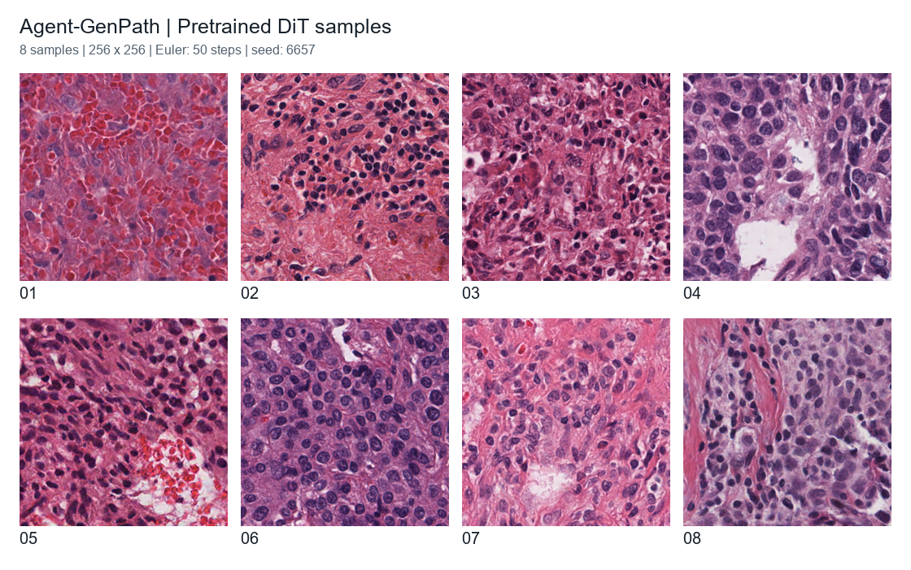

# Agent-GenPath

**Agent-Driven Generative Priors for Pathology Image Synthesis and Segmentation**

## Paper

arXiv: [**2611.06701**](https://arxiv.org/abs/2611.06701) | [PDF](https://arxiv.org/pdf/2611.06701).

## 🤗 Hugging Face: Model

- **Pretrained DiT**: [Download](https://huggingface.co/yscript/agent-genpath).

## Implementations

### Installation

Python 3.10, PyTorch 2.4.1, and CUDA 12.1 were used for the experiments.

```bash
pip install -r requirements.txt
```

Place the generative weights at `pretrained_checkpoints/dit.pth`. Set local data
and segmentation checkpoint paths in `configs/`. Run commands from the repository root.

## Dataset Structure

Organize the preprocessed PanNuke data as follows:

```text
data/pannuke/
├── images/
│   ├── fold1/
│   │   ├── 000001.npy
│   │   └── ...
│   ├── fold2/
│   └── fold3/
└── masks/
    ├── fold1/
    │   ├── 000001.npy
    │   └── ...
    ├── fold2/
    └── fold3/
```

Each `.npy` file stores one sample; image and mask filenames must match.
Images are RGB arrays of shape `(H, W, 3)` in `[0, 255]` or `[0, 1]`.
Masks are semantic label arrays of shape `(H, W)` with integer class IDs `0–5`.
Convert PanNuke instance annotations to these semantic maps before use.

Set `data.root` in `configs/train.json` and `configs/evaluate.json` to the dataset
root. Each entry in `splits` follows the order `[train, validation, test]`.

## Image Segmentation

### Training

```bash
python -m segmentation.train --gpu 0 --background
```

Defaults: three folds, 20 epochs per fold, and `t=0.3` (`configs/train.json`).

### Inference

```bash
CUDA_VISIBLE_DEVICES=0 python -m segmentation.infer \
  --input /path/to/images --checkpoint /path/to/segmentation.pth
```

### Evaluation

```bash
CUDA_VISIBLE_DEVICES=0 python -m segmentation.evaluate
```

## Image Generation

```bash
CUDA_VISIBLE_DEVICES=0 python -m generation.sample \
  --num-samples 8 --batch-size 8 --steps 50 --set seed=6657
```

Eight synthetic pathology patches sampled with the pretrained DiT (seed 6657,
50 Euler steps).



[Original images and sampling details](examples/samples).

## Citation

If you find this work useful in your research, please consider citing:

```bibtex
@misc{yang2026agentdrivengenerativepriorspathology,
      title={Agent-Driven Generative Priors for Pathology Image Synthesis and Segmentation},
      author={Sicheng Yang and Rui Tang and Haipeng Zhou and Hongqiu Wang and Zhaohu Xing and Jianda Ma and Lie Dai and Guang Yang and Lei Zhu},
      year={2026},
      eprint={2611.06701},
      archivePrefix={arXiv},
      primaryClass={cs.CV},
      url={https://arxiv.org/abs/2611.06701},
}
```
